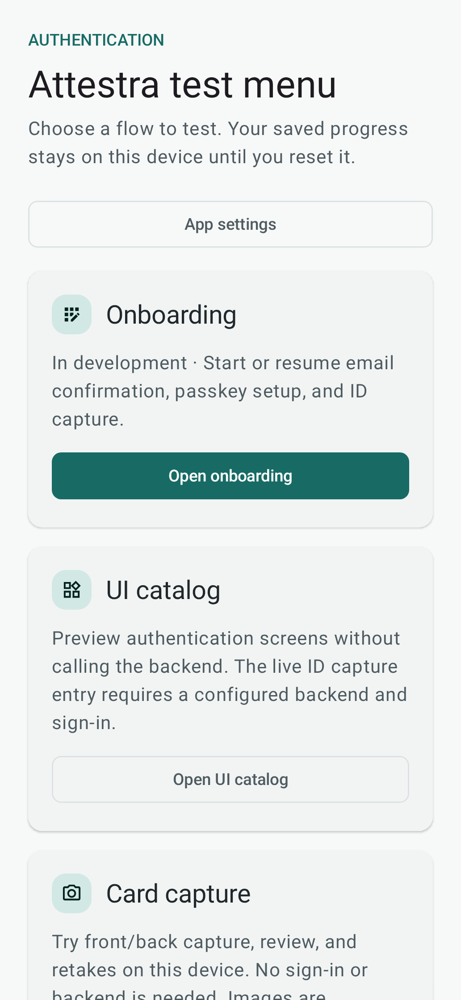
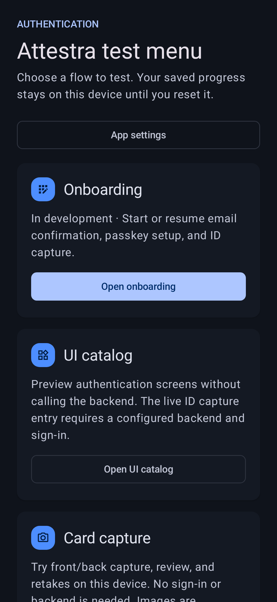
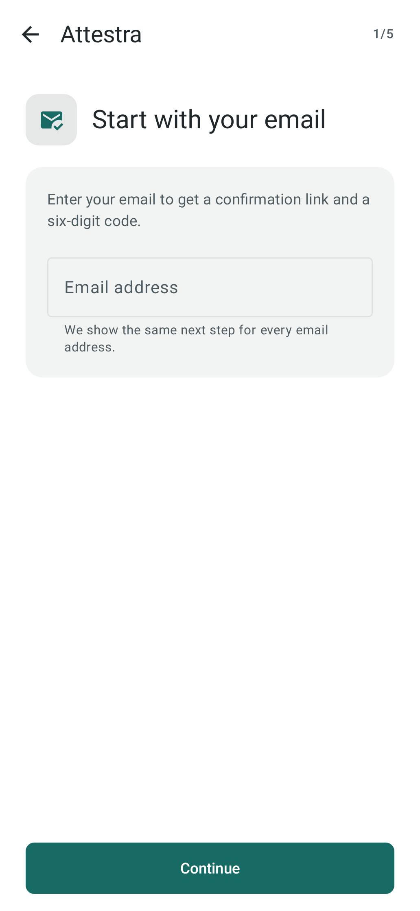
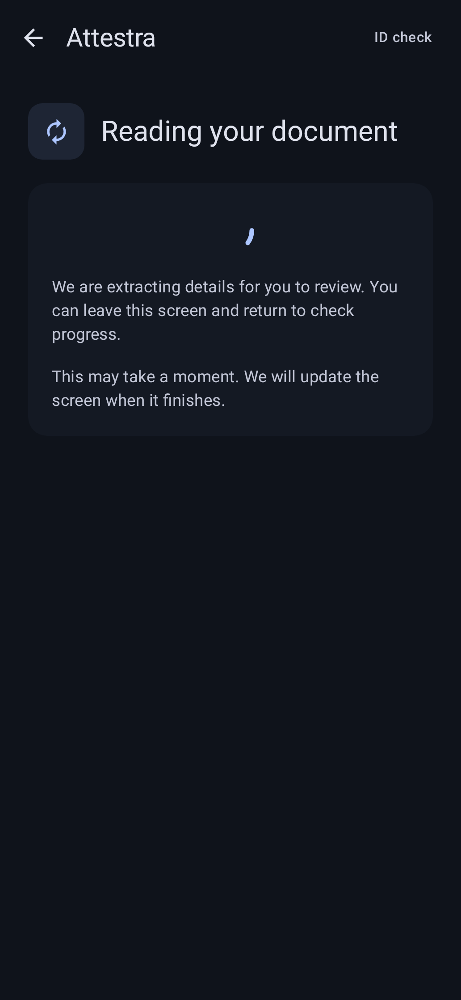
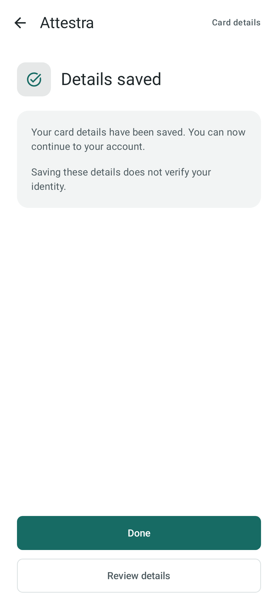

# Runnable demos and UI evidence

Scope: Development/source. Build [the complete sample](../../app/src/main/java/com/apexfission/android/auth/MainActivity.kt)
using [quickstart](quickstart.md).

| Entry / scenario | Prerequisites and actions | Expected result / failure | Source |
| --- | --- | --- | --- |
| App settings | Available at the top of the launcher, before backend setup or camera permission; open it and press system Back | Android application details for the installed demo package; returns to a usable menu | `OnboardingEntryScreen`, `MainActivity.openAppSettings` |
| Open onboarding | Matching backend/settings; request email, follow link or enter code, register passkey or permitted password | Server-confirmed auth/account state; recover cancelled sheets and stale settings | `MainActivity`, `EmailOnboardingHost` |
| Open UI catalog | Debug or release sample; choose each screen | State-driven UI only, no backend mutation. Older identity-decision screens are design mockups | `OnboardingCatalog` |
| Open card capture demo | No sign-in/backend; capture front/back, review and retake | Local completion only; images are discarded on confirmation or exit; retry/cancel returns safely | `LocalCardCaptureDemo`, `IdentityCamera` |
| Live ID capture | Signed-in matching account, current disclosure and policy | Private upload, async checks/extraction, manual fallback, exact server-confirmed save | `LiveCaptureFlow`, `CaptureHost` |
| Screenshots | Host renderer, no emulator/service/credentials; run named fixture suite | Synthetic component-preview images and machine manifest; failure if scenarios are missing | [Screenshot maintenance](../screenshots.md) |

Inspect **loading/error/recovery**, both capture sides, retake, required/optional
policy, failed upload, failed extraction, failed save and re-entry in relevant demos.
A static image is not proof that App Links, camera focus or platform permissions work.

## App settings and device checks

The app consumes the local `:auth` module and UI Common's shared catalog. The
header action uses `Settings.ACTION_APPLICATION_DETAILS_SETTINGS` with the runtime
`packageName`, including application-ID variants. It is available during reset and
when environment discovery fails. Its label is localized in English and Spanish;
the existing demo menu text remains English.

Settings changes do not grant permissions in app state. The launcher owns no cached
camera grant: entering local capture creates its permission host, and the live
post-disclosure camera rechecks Android permission state on resume. Returning from
Settings must leave the menu usable; changing camera permission can also cause
Android to recreate the process. The app's existing saved-progress/reset rules apply.
App Link diagnostics compare website associations; changing supported-link settings
does not publish a new association or replace the manual **Recheck** action.

```sh
./gradlew :app:assembleDebug :app:installDebug
adb shell am start -n com.apexfission.android.auth/.MainActivity
```

Run on a fresh test installation, or revoke the camera grant before instrumentation:

```sh
adb shell pm revoke com.apexfission.android.auth android.permission.CAMERA
./gradlew :app:connectedDebugAndroidTest
```

The tests check the visible header/callback, exact settings intent/package, actual
Settings return, a platform camera grant while Settings is foreground, recreation,
and UI-catalog/back navigation. The test grant remains on the disposable emulator.
They do not verify camera image quality, live auth, or Android's permission-revocation
process kill. On a device, also deny/revoke camera access in App settings, return to
local capture, and check permission recovery; grant it and re-enter to check capture.

## Reviewed examples

| Launcher, light | Launcher, dark |
| --- | --- |
|  |  |







Images show implemented components with synthetic inputs, not real account results.
See the capture manifest for hashes, source fixtures and renderer/toolchain provenance.
