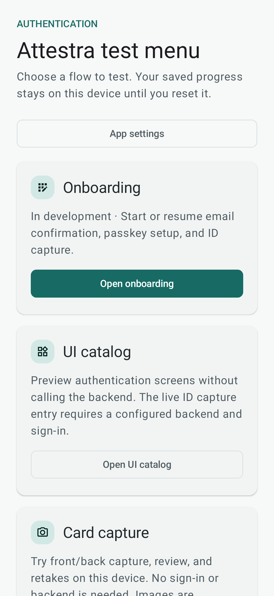
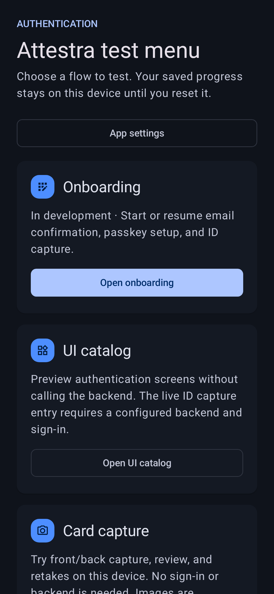
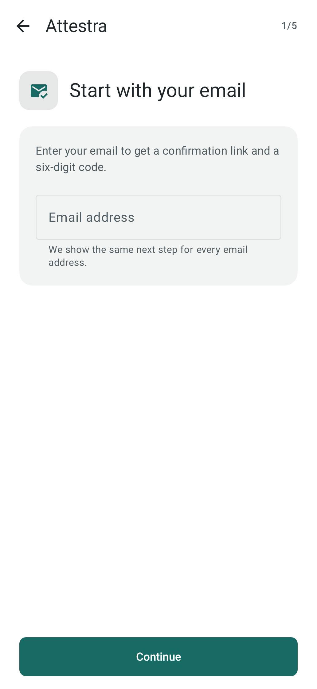
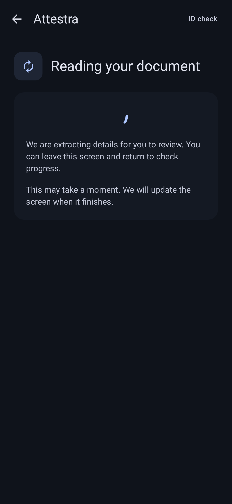
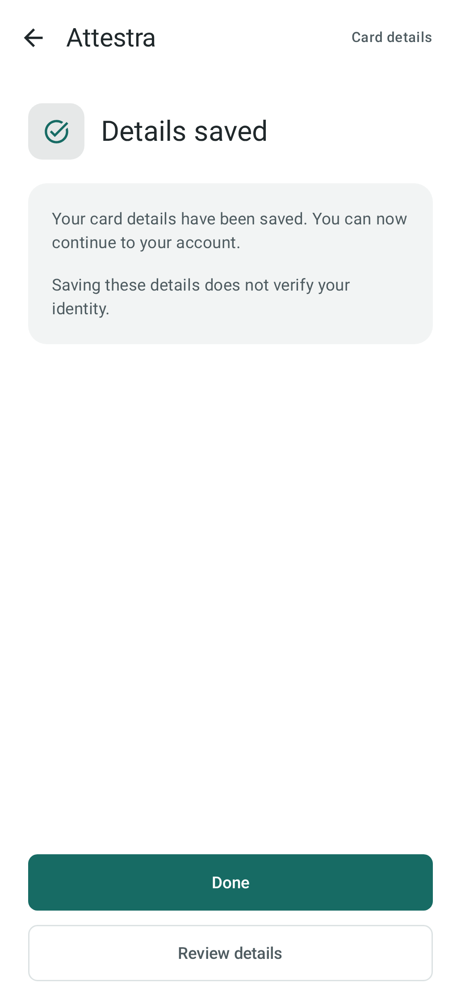

# Demos ejecutables y evidencia de UI

Ámbito: Desarrollo. Compile [el anfitrión completo](../../../app/src/main/java/com/apexfission/android/auth/MainActivity.kt)
con [inicio rápido](quickstart.md).

| Entrada | Requisitos y acciones | Resultado / fallo | Fuente |
| --- | --- | --- | --- |
| App settings | Disponible arriba del menú, antes del backend o del permiso de cámara; ábralo y vuelva con Atrás | Detalles de la aplicación instalada en Android; vuelve a un menú utilizable | `OnboardingEntryScreen`, `MainActivity.openAppSettings` |
| Open onboarding | Backend/ajustes compatibles; correo, enlace/código, passkey o contraseña permitida | Estado confirmado por servidor; recuperación de cancelaciones/ajustes | `MainActivity`, `EmailOnboardingHost` |
| Open UI catalog | Ejemplo debug/release; seleccione pantallas | Solo UI, sin mutar backend; decisiones antiguas son diseños | `OnboardingCatalog` |
| Open card capture demo | Sin sesión/backend; capture ambas caras, revise y repita | Solo finalización local; descarta imágenes al confirmar o salir; permite reintentar/cancelar | `LocalCardCaptureDemo`, `IdentityCamera` |
| Captura live | Cuenta autenticada, divulgación y política vigentes | Upload privado, procesamiento, manual y guardado confirmado | `LiveCaptureFlow`, `CaptureHost` |
| Capturas de documentación | Renderizador host sin emulador, servicios ni credenciales | Fixtures sintéticos con manifiesto; falla si faltan escenarios | [Mantenimiento](../../screenshots.md) |

Pruebe estados de carga/error/recuperación, ambas caras, retoma, políticas,
fallos de upload/extracción/guardado y reingreso en los demos correspondientes.
Una imagen estática no prueba App Links, foco o permisos reales.

## Ajustes de la aplicación y pruebas en dispositivo

La app consume el módulo local `:auth` y el catálogo compartido de UI Common. La
acción superior usa `Settings.ACTION_APPLICATION_DETAILS_SETTINGS` con el
`packageName` real, incluidas variantes del ID de aplicación. Está disponible durante
el borrado local y si falla el descubrimiento del entorno. Su etiqueta está traducida
al inglés y al español; el resto del menú existente permanece en inglés.

Los cambios de Ajustes no conceden permisos en el estado de la app. El menú no conserva
un permiso de cámara: al entrar en captura local se crea su anfitrión de permisos;
la cámara live posterior al consentimiento consulta Android al reanudarse. Al volver,
el menú debe funcionar; cambiar el permiso también puede hacer que Android recree el
proceso. Se mantienen las reglas existentes de progreso guardado y borrado local.
El diagnóstico de App Links compara asociaciones del sitio; cambiar los enlaces
admitidos no publica una asociación ni reemplaza la acción manual **Recheck**.

```sh
./gradlew :app:assembleDebug :app:installDebug
adb shell am start -n com.apexfission.android.auth/.MainActivity
```

Use una instalación de prueba nueva o revoque la cámara antes de instrumentar:

```sh
adb shell pm revoke com.apexfission.android.auth android.permission.CAMERA
./gradlew :app:connectedDebugAndroidTest
```

Las pruebas comprueban el botón/callback, intent y paquete exactos, vuelta real desde
Ajustes, concesión de cámara por Android mientras Ajustes está en primer plano,
recreación y navegación catálogo/Atrás. La concesión permanece en el emulador de prueba.
No comprueban calidad de imagen, auth live ni la terminación del proceso al revocar
permisos. En un dispositivo, deniegue/revoque la cámara desde Ajustes, vuelva a captura
local y compruebe la recuperación; después concédala y vuelva a entrar para capturar.

## Ejemplos revisados

| Menú, tema claro | Menú, tema oscuro |
| --- | --- |
|  |  |







Son componentes implementados con entradas sintéticas, no resultados de cuentas
reales. Consulte el manifiesto para hashes, fixtures y procedencia del renderizador.
